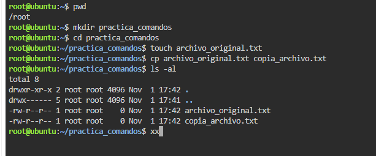
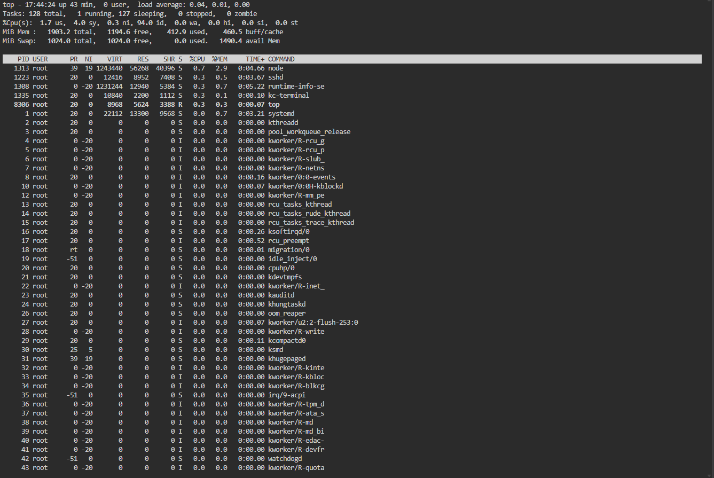
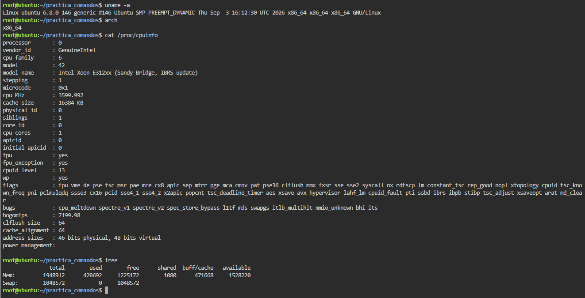
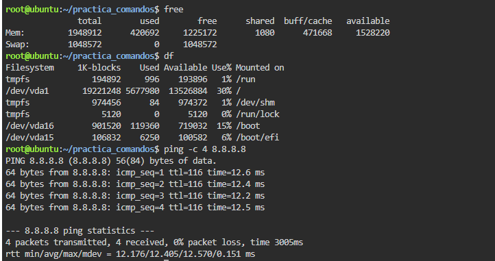

# TP: Comandos Básicos, Procesos y Utilidades en Linux

* **Materia:** Mantenimiento de Software
* **Estudiante:** Artaza
* **Fecha de Entrega:** 2026
* **Profesor:** 

---

## 1. Gestión de Archivos y Directorios

En este ejercicio se practicó la navegación dentro del sistema de archivos, la creación de carpetas y archivos, la copia de ficheros y el listado detallado.

### Evidencia:

* **Explicación de la diferencia entre `ls` simple y `ls -al`:**
  - El comando `ls` en su forma básica únicamente lista los nombres de los archivos y subdirectorios visibles dentro del directorio actual, sin mostrar detalles adicionales ni elementos ocultos.
  - La combinación de opciones `-al` (o `-a -l`):
    - `-a` (*all*): Incluye todos los archivos y carpetas, incluyendo los **archivos ocultos** (aquellos cuyo nombre comienza con un punto `.`, como `.`, `..` y archivos de configuración).
    - `-l` (*long*): Presenta el listado en **formato largo/detallado**, mostrando los permisos de acceso, cantidad de enlaces, propietario, grupo, tamaño en bytes y fecha/hora de última modificación de cada elemento.

---

## 2. Monitoreo de Procesos

Supervisión y control del ciclo de vida de los procesos en ejecución dentro del sistema operativo.

### Evidencia:

* **Diferencia entre `ps` y `top`:**
  - **`ps` (sin opciones):** Proporciona una captura o "foto" estática en ese instante de los procesos propios que se iniciaron en la sesión actual de la terminal. Una vez mostrada la tabla, el comando finaliza.
  - **`top`:** Es una herramienta interactiva en tiempo real. Muestra de forma dinámica y continua todos los procesos en ejecución en el sistema global, ordenados por consumo de recursos (CPU y memoria), actualizándose cada pocos segundos y permitiendo interactuar (por ejemplo, presionar `h` para ayuda o `q` para salir).

* **Uso del comando `kill pid` en caso de un programa colgado:**
  - El comando `kill <PID>` se utiliza para enviar una señal de terminación a un proceso específico identificado por su número de ID único (**PID**), obtenido previamente mediante `ps` o `top`.
  - Su utilidad principal radica en forzar el cierre de programas o procesos que han quedado congelados, bloqueados o consumiendo recursos indebidos, liberando de inmediato la memoria y los ciclos de CPU sin necesidad de reiniciar el sistema.

---

## 3. Información del Sistema y del Núcleo (Kernel)

Reconocimiento del hardware, arquitectura del equipo y recursos disponibles de memoria.

### Evidencia:

* **Detalles del Kernel y Memoria:**
  - **`uname -a` (Información del Núcleo):** Proporciona un resumen exhaustivo del sistema y del kernel: el nombre del sistema operativo (`Linux`), el nombre de red del host/máquina, la versión exacta y nivel de parche del kernel (kernel release), la fecha y hora de compilación del núcleo, y la arquitectura de la máquina (por ejemplo, `x86_64`).
  - **`free` (Memoria del Sistema):** Informa el estado y capacidad de la memoria física (**RAM**) y de la memoria de intercambio (**SWAP**), discriminando los valores en memoria total, utilizada, libre, compartida, y la memoria reservada para buffers y caché del sistema.

---

## 4. Red y Espacio en Disco

Verificación del almacenamiento disponible en las particiones montadas y diagnóstico de conectividad en la red.

### Evidencia:

* **Funcionamiento y objetivo de `ping` en una red TCP/IP:**
  - El comando `ping` es la herramienta de diagnóstico por excelencia para comprobar que las funciones básicas de una red TCP/IP funcionan correctamente y que existe conectividad con un host o servidor determinado (por ejemplo, `8.8.8.8`).
  - **Funcionamiento:** Envía pequeños paquetes de control ICMP (*Echo Request*) al destino solicitando una confirmación de recepción inmediata (*Echo Reply*).
  - **Objetivo:** Permite determinar si el destino es alcanzable a través de la red, verificar la estabilidad de la transmisión, medir los tiempos de respuesta o latencia (en milisegundos) y detectar si se produce pérdida de paquetes.

