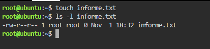
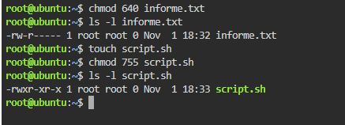
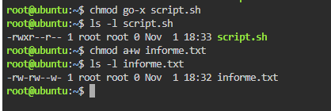
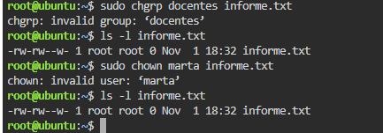
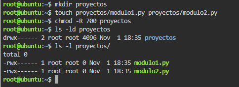

# TP: Permisos de Archivos, Directorios y Propiedad en Linux

* **Materia:** Mantenimiento de Software
* **Estudiante:** Artaza
* **Fecha de Entrega:** 2026
* **Profesor:** 

---

## 1. Lectura e Interpretación de Permisos (`ls -l`)

En Linux, cada archivo y directorio implementa un esquema de seguridad basado en tres niveles de acceso: Propietario (*user*), Grupo (*group*) y el Resto del mundo (*others*).

### Evidencia:

| Posición | Representación | Significado / Permiso |
| :--- | :--- | :--- |
| **Tipo de archivo** | `-` / `d` / `l` | El primer carácter identifica la naturaleza del elemento: `-` indica un archivo regular/común (texto, script, imagen, etc.), `d` representa un directorio y `l` representa un enlace simbólico (*link* o acceso directo). |
| **Propietario (`u`)** | `rwx` (posiciones 2, 3 y 4) | Permisos del usuario dueño del archivo: `r` (lectura), `w` (escritura/modificación) y `x` (ejecución). Un guion `-` indica ausencia de dicho permiso. |
| **Grupo (`g`)** | `rwx` (posiciones 5, 6 y 7) | Permisos asignados a los usuarios que pertenecen al grupo propietario del archivo (`r`: lectura, `w`: escritura, `x`: ejecución). |
| **Otros (`o`)** | `rwx` (posiciones 8, 9 y 10) | Permisos asignados al resto de los usuarios del sistema que no son el dueño ni forman parte del grupo propietario. |

---

## 2. Permisos en Modo Octal

El formato octal codifica los permisos asignando una potencia binaria a cada bit: Lectura ($r = 4$), Escritura ($w = 2$) y Ejecución ($x = 1$). La suma de los bits activos conforma el dígito de cada nivel.

### Evidencia:

* **Desglose numérico $640$ (`rw-r-----` aplicado a `informe.txt`):**
  - **Propietario ($u$):** $r(4) + w(2) + -(0) = \mathbf{6}$ (Lectura y Escritura).
  - **Grupo ($g$):** $r(4) + -(0) + -(0) = \mathbf{4}$ (Solo Lectura).
  - **Otros ($o$):** $-(0) + -(0) + -(0) = \mathbf{0}$ (Sin ningún permiso).
  - **Total octal:** `640`.

* **Desglose numérico $755$ (`rwxr-xr-x` aplicado a `script.sh`):**
  - **Propietario ($u$):** $r(4) + w(2) + x(1) = \mathbf{7}$ (Lectura, Escritura y Ejecución).
  - **Grupo ($g$):** $r(4) + -(0) + x(1) = \mathbf{5}$ (Lectura y Ejecución).
  - **Otros ($o$):** $r(4) + -(0) + x(1) = \mathbf{5}$ (Lectura y Ejecución).
  - **Total octal:** `755`.

---

## 3. Modo Simbólico

La notación simbólica permite ajustar los privilegios mediante letras representativas de usuarios (`u`, `g`, `o`, `a`) y operadores de acción (`+` para conceder, `-` para revocar).

### Evidencia:

* **Ventaja del modo simbólico frente al modo octal:**
  - La principal ventaja práctica es que **permite añadir o quitar un permiso específico de forma granular sin necesidad de conocer, recalcular o sobrescribir los permisos preexistentes** de los otros niveles.
  - En el modo octal, para cambiar un solo bit es obligatorio especificar siempre el valor de las 3 ternas completas, lo que incrementa el riesgo de modificar accidentalmente los permisos del dueño o del grupo. En cambio, con la notación simbólica basta con indicar la acción puntual (por ejemplo, `chmod go-x script.sh` retira solo la ejecución a grupo y otros, o `chmod a+w informe.txt` agrega escritura a todos manteniendo sus lecturas intactas).

---

## 4. Cambio de Propietario y Grupo

La pertenencia y titularidad de los archivos definen qué políticas de acceso y auditoría se aplicarán al usuario en sesión.

### Evidencia:

* **¿Por qué se requiere privilegio superusuario (`sudo` / `root`) para `chown`?:**
  - Por una **razón crítica de seguridad e integridad del sistema**. Si los usuarios estándar pudieran transferir la propiedad de sus archivos a otros usuarios libremente:
    1. Podrían eludir las políticas de cuotas de disco, creando archivos pesados y asignándolos a otra persona para saturar el almacenamiento de esa cuenta.
    2. Podrían evadir responsabilidades en auditorías de seguridad, "abandonando" archivos maliciosos o comprometedores bajo la autoría de otro usuario.
  - Por estos motivos de protección del sistema multiusuario, el kernel de Linux restringe la invocación del comando `chown` exclusivamente al administrador (`root`).

---

## 5. Permisos Recursivos en Directorios

La opción `-R` (*recursive*) aplica las directivas de seguridad a un directorio y a todo su contenido descendente de manera automática.

### Evidencia:

* **Importancia del permiso de ejecución (`x`) en un directorio:**
  - En un directorio, el bit de ejecución (`x`) no significa ejecutar un programa, sino que **representa el permiso de acceso o travesía (*traverse/search*)**. Concede la capacidad de ingresar a la carpeta (por ejemplo mediante `cd`) y acceder a los inodos de los archivos y subdirectorios allí contenidos.
  - **¿Qué ocurre si a un directorio se le quita el permiso `x`?**
    - El usuario no podrá ingresar al directorio (`cd proyectos` devolverá error de *Permiso denegado*).
    - Aunque el directorio conserve permiso de lectura (`r`), el usuario no podrá acceder, ver atributos detallados, editar ni ejecutar ninguno de los archivos contenidos en su interior (`modulo1.py`, `modulo2.py`), ya que el sistema operativo tiene bloqueada la resolución de la ruta.

