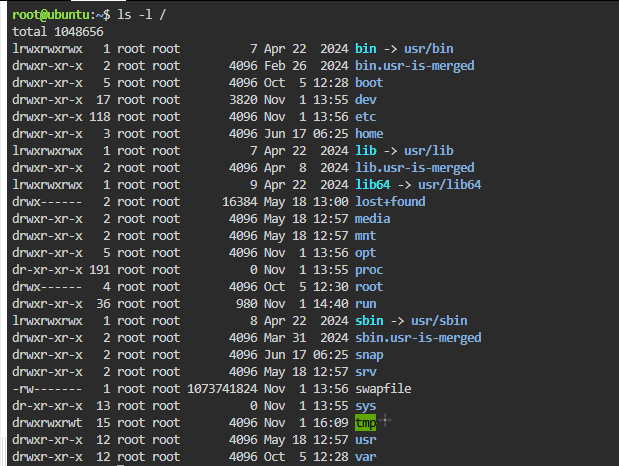
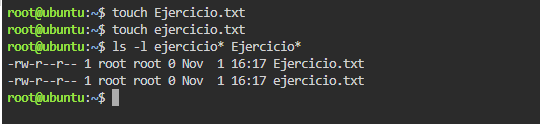
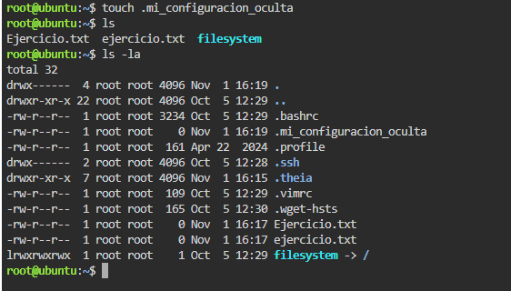
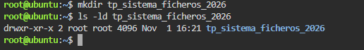
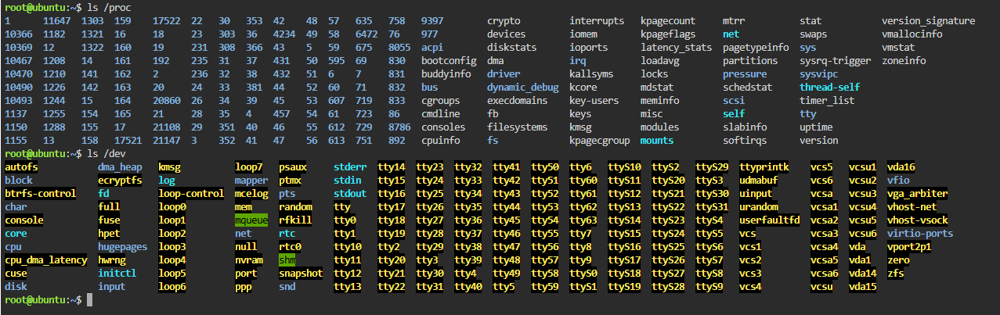

# TP: Sistema de Archivos en Linux

* **Materia:** Mantenimiento de Software
* **Estudiante:** Artaza
* **Fecha de Entrega:** 2026
* **Profesor:** 

---

## 1. Estructura del Árbol de Directorios

Linux organiza sus directorios partiendo desde la raíz `/`.

### Evidencia:

### Función de los directorios según la guía:
| Directorio | Función según la guía |
| :--- | :--- |
| `/etc` | Contiene los archivos de configuración de la mayoría de los programas. |
| `/home` | Contiene los archivos personales de los usuarios. |
| `/dev` | Contiene archivos simbólicos que representan partes del hardware, tales como discos duros, memoria, etc. |
| `/var` | Contiene datos variables como registros de actividad (logs) de programas, bases de datos, contenidos de servidor web y copias de seguridad. |

---

## 2. Sensibilidad a Mayúsculas y Minúsculas (Case Sensitivity)

En Linux, los nombres de archivos distinguen entre mayúsculas y minúsculas (*case sensitive*).

### Evidencia:

### Respuesta:
**¿Por qué en Linux es posible tener `Ejercicio.txt` y `ejercicio.txt` en la misma carpeta a diferencia de Windows?**

En Linux y en sistemas tipo UNIX, los sistemas de archivos (como ext4) son estrictamente sensibles a mayúsculas y minúsculas (*case sensitive*). Cada carácter se almacena según su código binario/ASCII, por lo cual `'E'` y `'e'` son tratados como caracteres completamente distintos. Por ende, `Ejercicio.txt` y `ejercicio.txt` son dos nombres de archivo diferentes y pueden coexistir en la misma carpeta.

En Windows, por el contrario, los sistemas de archivos habituales (como NTFS y FAT) son por defecto *case-preserving* pero no *case-sensitive* (insensibles a mayúsculas/minúsculas para el usuario). Esto significa que recuerdan cómo se escribieron las mayúsculas, pero al buscar, abrir o crear un archivo consideran que `Ejercicio.txt` y `ejercicio.txt` son el mismo nombre, impidiendo que existan simultáneamente en la misma ruta.

---

## 3. Visualización y Gestión de Archivos Ocultos

Los archivos o directorios ocultos en Linux comienzan su nombre con un punto (`.`).

### Evidencia:

### Utilidad de los archivos ocultos:
La principal utilidad de los archivos ocultos es almacenar información de configuración del sistema, del entorno de usuario (como `.bashrc` o `.profile`) y preferencias específicas de las aplicaciones. Al estar ocultos:
- Se mantiene un entorno visual limpio y ordenado al ejecutar un simple listado con `ls` o navegar en el gestor de archivos.
- Se previene la modificación o eliminación accidental de archivos críticos de configuración por parte del usuario en el trabajo diario.

---

## 4. Buenas Prácticas en Nombres de Archivos

En UNIX/Linux se recomienda evitar espacios, caracteres especiales, acentos o la letra "ñ".

### Evidencia:

### Justificación:
- **`tp_sistema_ficheros_2026` cumple con las recomendaciones:** Utiliza exclusivamente letras del alfabeto en minúsculas (a-z), números (0-9) y guiones bajos (`_`) para separar palabras. Es un nombre claro, fácil de referenciar en la consola y no requiere escapar caracteres ni usar comillas al ejecutar comandos o programar scripts.
- **`TP Sistema de Ficheros (Año 2026)!.doc` no cumple con las recomendaciones:**
  1. **Espacios en blanco:** En la terminal de Linux el espacio actúa como separador de argumentos, obligando a usar comillas o barras invertidas para escapar cada espacio (ej. `TP\ Sistema...`).
  2. **Caracteres especiales y de puntuación:** Los paréntesis `()` y el signo de exclamación `!` son caracteres reservados o con funciones especiales en la shell (por ejemplo, `!` se utiliza para invocar el historial de comandos).
  3. **Acentos y caracteres no estándar:** La letra `ñ` y letras acentuadas pueden generar incompatibilidades según la codificación de caracteres del sistema o al compartir archivos entre diferentes plataformas.

---

## 5. Exploración de Dispositivos y Procesos

El hardware y los procesos del sistema se representan como archivos en los directorios `/dev` y `/proc`.

### Evidencia:

### Información que almacena el directorio `/proc`:
El directorio `/proc` es un pseudo-sistema de archivos virtual generado en memoria RAM en tiempo real por el kernel de Linux (no reside en el disco físico). Almacena:
- **Información temporal sobre los procesos en ejecución:** Cada proceso activo tiene un subdirectorio identificado por su PID (Process ID) que contiene su estado, variables de entorno, descriptores de archivos y uso de memoria.
- **Estado del kernel y hardware:** Archivos informativos del sistema como `/proc/cpuinfo` (procesador), `/proc/meminfo` (uso de memoria RAM), `/proc/version` (versión del kernel), entre otros parámetros del sistema operativo.
