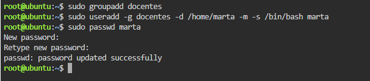
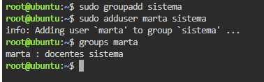
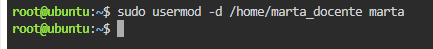
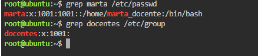
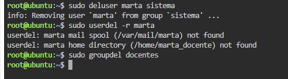

# TP: Administración de Usuarios y Grupos en Linux

* **Materia:** Mantenimiento de Software
* **Estudiante:** Artaza
* **Fecha de Entrega:** 2026
* **Profesor:** 

---

## 1. Creación de Grupos y Usuarios

La administración de usuarios y grupos en Linux es una tarea reservada exclusivamente al usuario `root` o a usuarios autorizados mediante privilegios administrativos (`sudo`).

### Evidencia:


* **Explicación del parámetro `-m` en `useradd`:**
  - El parámetro `-m` (*make home*) le indica al comando `useradd` que debe **crear automáticamente el directorio personal (*home*)** del usuario (junto con los archivos base de configuración tomados de `/etc/skel`) en caso de que no exista previamente.
  - **¿Qué sucedería si se omite?** Si no se utiliza la opción `-m`, la cuenta de usuario se creará en el sistema pero su carpeta personal no existirá físicamente en el disco. En consecuencia, el usuario no dispondrá de su espacio de trabajo al iniciar sesión a menos que el administrador cree la carpeta y configure sus permisos de forma manual.

---

## 2. Gestión de Grupos Secundarios

En los sistemas operativos basados en UNIX/Linux, una cuenta de usuario posee un único grupo primario, pero puede formar parte de múltiples grupos secundarios para acceder a diferentes recursos o privilegios.

### Evidencia:


* **Comando para quitar usuario de un grupo secundario:**
  - Para remover a un usuario de un grupo secundario se utiliza el comando:
    ```bash
    sudo deluser <nombre_usuario> <nombre_grupo>
    ```
    *(Por ejemplo: `sudo deluser marta sistema`)*.
  - Otra alternativa estándar del sistema es mediante `sudo gpasswd -d marta sistema`.

---

## 3. Modificación de Usuarios

El sistema provee herramientas diferenciadas tanto para el alta de cuentas como para su posterior administración y mantenimiento.

### Evidencia:


* **Diferencia fundamental entre `useradd` y `usermod`:**
  - **`useradd`:** Se utiliza para **dar de alta / crear** una nueva cuenta de usuario en el sistema operativo desde cero, estableciendo sus parámetros iniciales (UID, grupo primario, directorio personal, shell por defecto).
  - **`usermod`:** Se utiliza para **modificar y actualizar** los parámetros o propiedades de un usuario que **ya existe previamente** (por ejemplo, cambiar su directorio home con `-d`, modificar su shell predeterminada con `-s`, cambiar su nombre de login o reasignar sus grupos).

---

## 4. Ficheros de Configuración

Toda la base de datos de usuarios, credenciales y grupos de Linux se gestiona a través de archivos de texto plano estructurados dentro de `/etc`.

### Evidencia:


| Fichero | Contenido / Función según la guía |
| :--- | :--- |
| `/etc/passwd` | Almacena la información de las cuentas de usuario del sistema (nombre de usuario, marcador de contraseña cifrada `x`, UID numérico, GID del grupo primario, descripción/nombre completo, ruta del directorio *home* y la shell asignada). Es legible por todos los usuarios del sistema. |
| `/etc/group` | Almacena la información de los grupos de usuarios configurados en el sistema (nombre del grupo, contraseña de grupo `x`, GID numérico y la lista de usuarios secundarios que pertenecen a dicho grupo). |
| `/etc/shadow` | Almacena las contraseñas encriptadas (hashes de seguridad) de las cuentas de usuario y las directivas de seguridad (caducidad de contraseñas, días de gracia, expiración de cuentas, etc.). Por motivos críticos de seguridad, únicamente tiene permisos de lectura el superusuario `root`. |

---

## 5. Eliminación de Usuarios y Grupos

Al realizar el mantenimiento y limpieza de cuentas obsoletas, deben gestionarse adecuadamente tanto los registros de usuario como sus datos residuales y dependencias de grupos.

### Evidencia:


* **Uso del parámetro `-r` en `userdel`:**
  - El parámetro `-r` (*remove*) le indica al comando `userdel` que elimine no solo la entrada del usuario en el archivo de cuentas, sino también **su directorio personal (*home*) y su cola/buzón de correo (*mail spool*)** de manera automática. Si no se utiliza `-r`, la carpeta home queda huérfana en el disco duro ocupando espacio y sin propietario válido.
* **Condición para borrar un grupo con `groupdel`:**
  - El requisito obligatorio es que **ningún usuario activo tenga asignado dicho grupo como su grupo primario**. Si un usuario aún tiene el grupo configurado como principal, el sistema denegará la acción impidiendo que el grupo sea eliminado. Por este motivo, para poder ejecutar `groupdel docentes`, fue indispensable eliminar primero a la usuaria `marta` (o reasignarle otro grupo primario).

